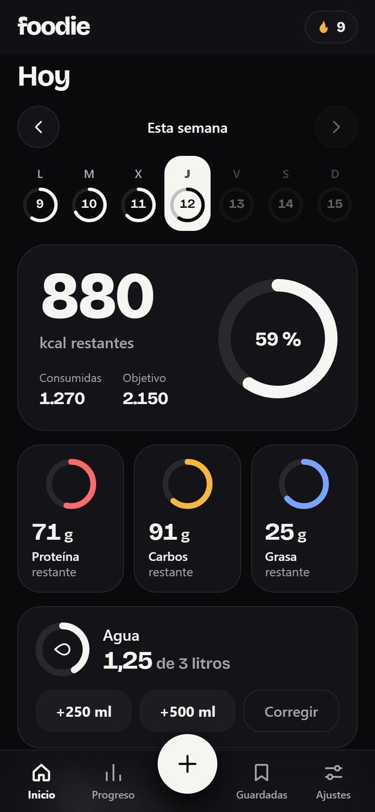
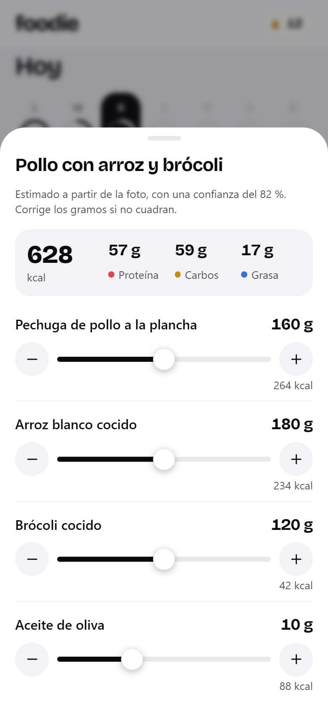
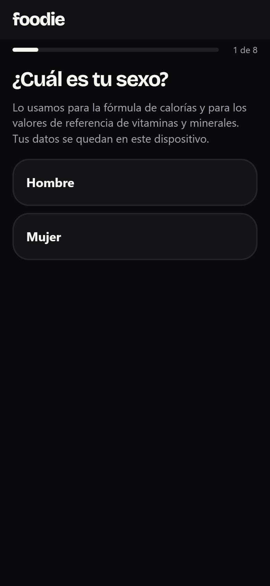

# foodie

A mobile-first PWA to track calories, macros, vitamins and minerals without weighing your food. Log a meal, then fix the portion with a slider: every number is recalculated on the device, instantly.

**Live app:** https://imsothe.github.io/foodie/ (open it on your phone and add it to the home screen)

<p>
  
  
  
</p>

## Why this exists

I wanted to track what I eat without weighing food, and the two kinds of app on offer each fail in their own way.

The fast ones (take a photo, get calories) are subscription products, and when the AI misjudges a portion, correcting it is slow: you retype numbers or ask the AI again. The free ones make you search and weigh everything, which is hard to keep up. I had already built an expense tracker for myself and learned from it that if logging takes effort, even its author stops using it.

So the goal was set before any code: **logging a meal has to be easier than not logging it**, and it has to cost nothing to run.

## How the idea took shape

I started by taking apart the experience of the photo calorie trackers that people actually stick with: a week strip at the top, one big "calories left" ring, three macro cards, a camera one tap away. That part works, so foodie keeps the pattern (with its own design, name and code).

Then I looked for where they hurt, and it came down to one design decision. They store a meal as a result: "chicken with rice, 628 kcal". Change the portion and the result is stale, so the app has to recompute it somewhere else.

foodie stores every food the same way, whatever its source:

```
composition per 100 g  +  grams on the plate
```

Totals are never stored. They are always derived (`per100 × grams / 100`). Moving a slider changes one number, and calories, macros and 18 other nutrients follow on the device, with no network and no AI call. The AI is asked once for the two things it is good at: naming what is on the plate and estimating how much there is. Everything after that is arithmetic.

That one rule shaped the rest:

- A photo, a barcode, a nutrition label and a typed search all produce the same kind of record, so there is one editor, one set of totals and one test suite for all of them.
- Three of the four ways to log use no AI at all, so the app stays useful when the AI is wrong, slow or out of quota.
- Micronutrients come for free: if the composition has them, the totals have them.

## Decisions that mattered

| Decision | Why | What it cost |
|---|---|---|
| No framework, no build step, no runtime dependencies | The app is a handful of screens. Plain ES modules are served as written, there is no supply chain to audit, and the Content Security Policy can stay at `script-src 'self'`. | More hand-written UI code, and a small tool (`npm run stamp`) to version the offline cache. |
| The DOM is built with `createElement` and text nodes, never from HTML strings | Text from a food database or an AI must never be able to run as code. This makes that a property of the code, not a matter of remembering to escape. | A slightly more verbose way to write screens. |
| Local-first: the app works fully without an account | It opens instantly, works offline, and sign-in becomes a backup feature instead of a gate. | Sync has to resolve conflicts: every record carries its edit time, deletions travel as tombstones, and merging is tested to give the same result in any order. |
| Carbohydrate means available carbohydrate, fibre counted apart | It is what EU labels and Open Food Facts use. Mixing it with the US "total carbohydrate" definition would silently double-count fibre. | US-sourced values are converted on import, and the energy check uses the EU factors (fibre at 2 kcal/g). |
| Food values come from USDA FoodData Central, not written by hand | The first table was typed from memory and passed every test, because the tests only checked internal consistency. I then compared it with the Spanish BEDCA database and found real gaps. BEDCA's terms do not allow republishing, so the table was rebuilt from USDA SR Legacy (public domain), each entry carrying its source id. | Seven Spain-specific foods have no USDA entry and are labelled `estimate`. |
| Goals from a standard formula, with floors | Mifflin-St Jeor for energy, protein and fat per kg of body weight, sex-specific reference intakes. A deficit never goes below a safe floor, and the app says when the floor was applied. | These are estimates, and the app says so. It is not medical advice. |
| Noncommercial licence instead of MIT | The code is public so it can be read and judged, but I may turn this into a product. | It is source-available, not open source in the strict sense. |

## Where it stands

Built in steps. This list only contains what exists.

| Step | What | State |
|---|---|---|
| 1 | Architecture and data model | Done |
| 2 | Repository, PWA shell, design system, automatic deploy | Done |
| 3a | Local-first app: profile and goals, daily log, food search, favourites, water, steps, progress, export | Done |
| 3b | Security hardening and the security test suite | Done |
| 3c | Google sign-in and cloud copy: built and tested with two simulated devices, sign-in verified up to Google's account page; a full sign-in with a real account is still to be exercised | Built, needs a real-account test |
| 4 | Camera: photo analysis with AI, barcode (Open Food Facts), nutrition label | Planned |

What works today, all on your device:

- **Onboarding:** sex, age, height, weight, activity and goal (lose, maintain, gain) give an editable daily plan: calories, protein, carbohydrate, fat, water and steps.
- **Log a meal by search** from about 100 common foods, with typical portions and a grams slider, several foods per meal. Fix the grams later, duplicate the meal on another day, save it as a favourite, delete with undo.
- **Home:** calories left, macros, water, steps, and vitamins and minerals against reference values for your sex. A week strip you can move back through.
- **Progress:** a month calendar of the days you met your goal, average calories per week, weight history.
- **Settings:** edit profile and goals (past days keep the goals they had), light and dark theme, export everything as JSON, delete it from the device.

- **Cloud copy (optional):** one button in Settings, "Continuar con Google". Meals, water, steps, favourites, weights, goals and profile sync between devices; the newest edit wins and a deletion on one phone reaches the others. The app works the same without an account.

Not there yet: the three camera options of the `+` menu (photo, barcode, label), which show a notice. Steps are typed by hand.

## Testing and security

This is the part I would look at first in someone else's repo, so it is the part I spent the most care on.

```bash
npm test          # 206 tests, no dependencies, about a second
npm run coverage  # 98 % lines, 89 % branches overall; most of the pure core is at 100 % lines
```

- **Unit tests** for every pure module: nutrition maths, goals (worked examples by hand for a man and a woman, floors, monotonicity), dates across daylight-saving changes, search, progress, the store.
- **Hostile-input fuzzing.** Every function that cleans data read from storage is hit with 33,000 generated inputs from a seeded generator: wrong types, `NaN`, huge numbers, 3,000 levels of nesting, getters that throw, `__proto__` and `constructor` keys. For each one the suite asserts: it never throws, the result is valid or null, cleaning twice equals cleaning once, and `Object.prototype` is untouched. A failure prints the seed to replay it.
- **An injection corpus** (script tags, event-handler attributes, `javascript:` URLs, bidi overrides, 100 kB strings) is pushed through every text field and through the DOM helper, which is tested against a fake DOM to prove payloads end up as text nodes.
- **Static guards** that run in CI: the CSP stays closed, no inline code, no `innerHTML` or `eval`, the offline cache matches the published files, every workflow action is pinned to a commit hash, no secrets or personal data are tracked, storage keys stay in the app's own namespace.
- **A real-browser check** with the same payloads seeded into storage and hostile URLs, repeatable with `tools/xss_fuzz_seed.js`.

The review that led to this found real defects, each now covered by a test that fails without its fix: a crafted link (`#constructor`) that blanked the app, a meal id of `__proto__` that corrupted a stored day, invisible and text-reversing characters accepted in names, a DOM helper that would have set an inline handler if given a string, and no size limits on stored data.

[SECURITY.md](SECURITY.md) has the threat model, including what is **not** defended. The most important limit: GitHub Pages serves all of an account's projects from one origin, so the browser does not isolate this app's local data from sibling apps.

## How it is built

```
app/
  core/      nutrition, goals, data shapes, routing, search, progress, dates (pure, no DOM, 100 % line coverage)
  data/      local store (validated on load, size-capped) and the table of foods
  ui/        DOM helper, ring, week strip, ingredient editor, screens
  css/       design tokens, base, components (light and dark from one set of tokens)
  sw.js      service worker: the whole app cached as one version
  boot.js    theme and anti-clickjacking, before first paint
tests/       unit tests, security suite, static guards
tools/       dev server, cache stamp, icon renderer, browser fuzz seed
```

- **Offline first.** `npm run stamp` writes the file list and a content hash into the service worker, and a test fails if it is out of date, so a deploy can never ship a cache that does not match the files.
- **Deploy.** Every push to `main` runs the tests and publishes `app/` to GitHub Pages. A failing test blocks the deploy.

## Run it locally

Requires Node 22 or newer. There is nothing to install.

```bash
npm run dev     # http://localhost:8790
npm test
npm run stamp   # after changing anything in app/, before committing
```

The service worker is off on localhost so you always get fresh files; add `?sw=1` to the URL to test offline behaviour.

## What I would not claim

- Nutrition figures are estimates. USDA values describe typical US foods; a Spanish product can differ, and for some foods public databases disagree with each other by more than 25 % (mussels, Greek yogurt, tofu, mozzarella). Seven foods are my own estimates and say so in the data.
- It has been exercised in desktop Chrome emulating a phone, in both themes. It has not been through a proper pass on real iOS and Android devices yet.
- Photo estimation, when it arrives, will be an estimate too. That is the reason the slider exists.

## Credits

- The home screen layout follows a pattern common to photo calorie trackers. foodie is an independent project with its own design, name and code.
- Food composition: U.S. Department of Agriculture, Agricultural Research Service. FoodData Central, SR Legacy (public domain, CC0). Available from https://fdc.nal.usda.gov/. Cross-checked against BEDCA, the Spanish food composition database, whose values are not reproduced here.
- Reference intakes: Regulation (EU) No 1169/2011 and EFSA dietary reference values.
- Typeface: [Bricolage Grotesque](https://github.com/ateliertriay/bricolage), SIL Open Font License 1.1.
- Built with AI coding assistants. I set the goal, the constraints and the acceptance criteria, reviewed the output, and had it verified in a browser and by tests before anything was published.

## Licence

[PolyForm Noncommercial 1.0.0](LICENSE.md). You can read, run and modify the code for any noncommercial purpose. Commercial use is reserved to the author.
